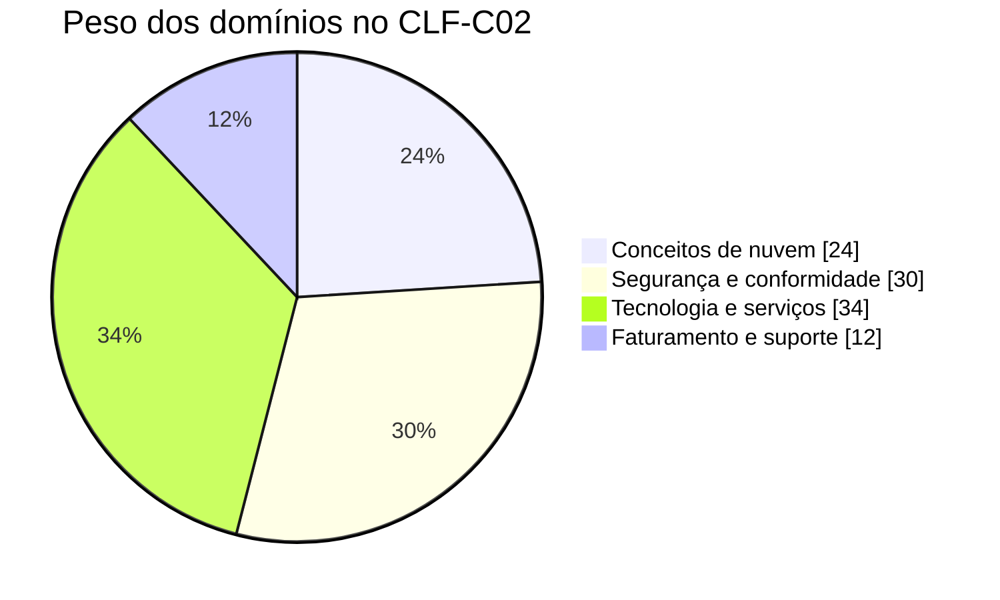

# Preparação para o AWS Certified Cloud Practitioner (CLF-C02)

Guia de estudos **em português** para a certificação **AWS Certified Cloud Practitioner**, organizado pelos **quatro domínios do exame CLF-C02**. Inclui resumos, comparativos dos serviços que mais confundem, plano de estudos de 6 semanas, checklist de progresso e um **simulado comentado de 30 questões**.

> Material de apoio às disciplinas de Computação em Nuvem — Prof. Eduardo Furlanetti.
> Formação complementar do autor em nuvem: AWS, Microsoft Azure (AI-900, DP-900, SC-900, PL-900) e Google Cloud.

## Sobre o exame

| Item | Detalhe |
|---|---|
| Código | **CLF-C02** |
| Questões | **65** (50 pontuadas + 15 não pontuadas, que não são identificadas) |
| Formato | Múltipla escolha (uma correta) e múltipla resposta (duas ou mais corretas) |
| Duração | **90 minutos** |
| Nota mínima | **700** em uma escala de 100 a 1.000 |
| Pontuação | Compensatória: é preciso passar no exame como um todo, não em cada domínio |
| Valor | **US$ 100** |
| Chute | Questão em branco conta como errada, e não há penalidade por erro: **responda todas** |

### Domínios e pesos

| Domínio | Peso | Resumo |
|---|---:|---|
| [1. Conceitos de nuvem](dominios/01-conceitos-de-nuvem.md) | 24% | Benefícios da nuvem, Well-Architected, CAF, migração e economia |
| [2. Segurança e conformidade](dominios/02-seguranca-e-conformidade.md) | 30% | Responsabilidade compartilhada, IAM, criptografia e serviços de segurança |
| [3. Tecnologia e serviços de nuvem](dominios/03-tecnologia-e-servicos.md) | **34%** | Infraestrutura global, computação, bancos, redes, armazenamento, IA e outros serviços |
| [4. Faturamento, preços e suporte](dominios/04-faturamento-precos-e-suporte.md) | 12% | Modelos de compra, ferramentas de custo e planos de suporte |



## Como usar este repositório

1. Siga o [**plano de estudos de 6 semanas**](plano-de-estudos.md).
2. Leia os resumos dos domínios na ordem e marque o progresso no [**checklist**](checklist.md).
3. Revise os [**comparativos**](resumos/comparativos.md): boa parte das questões pede para escolher entre serviços parecidos.
4. Faça o [**simulado**](simulado/simulado.md) cronometrado (40 minutos para 30 questões) e só depois confira o [**gabarito comentado**](simulado/gabarito.md).
5. Mire em **80% ou mais** nos simulados antes de agendar a prova.

## Estrutura

```
dominios/      resumos dos 4 domínios do exame
resumos/       comparativos de serviços e palavras-chave das questões
simulado/      30 questões no estilo do exame + gabarito comentado
plano-de-estudos.md
checklist.md
```

## Fontes oficiais

- [Página da certificação](https://aws.amazon.com/certification/certified-cloud-practitioner/)
- [Guia oficial do exame CLF-C02](https://docs.aws.amazon.com/aws-certification/latest/cloud-practitioner-02/cloud-practitioner-02.html)
- [AWS Skill Builder](https://skillbuilder.aws/), com o curso gratuito *AWS Cloud Practitioner Essentials* e a prova prática oficial
- [AWS Well-Architected Framework](https://aws.amazon.com/architecture/well-architected/)

> As informações refletem o guia do exame e as páginas oficiais da AWS consultadas em outubro de 2026. Preços, nomes de planos e detalhes do exame mudam: confira sempre as fontes oficiais antes da prova.

## Contribuições

Encontrou um erro ou quer sugerir uma questão? Abra uma *issue* ou um *pull request*.

## Licença

[MIT](LICENSE)
